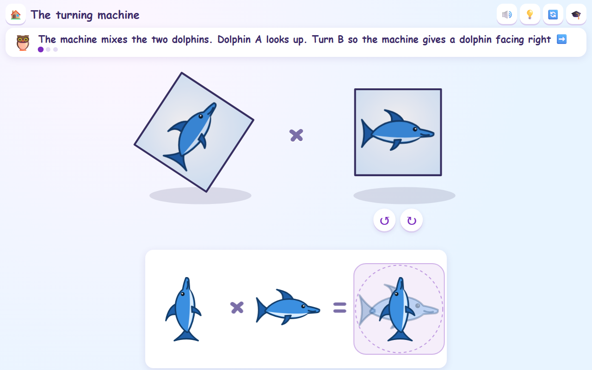
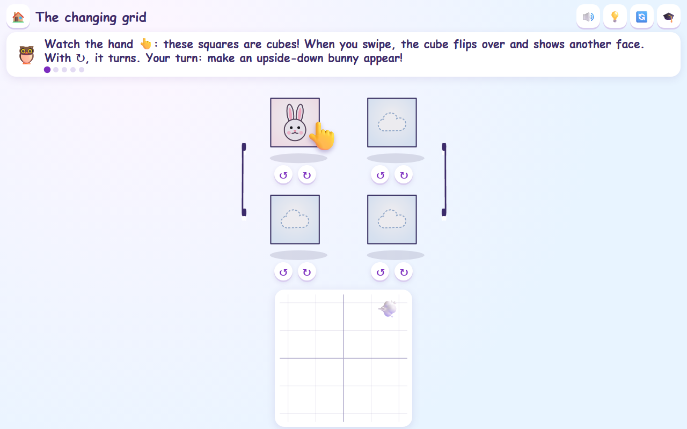
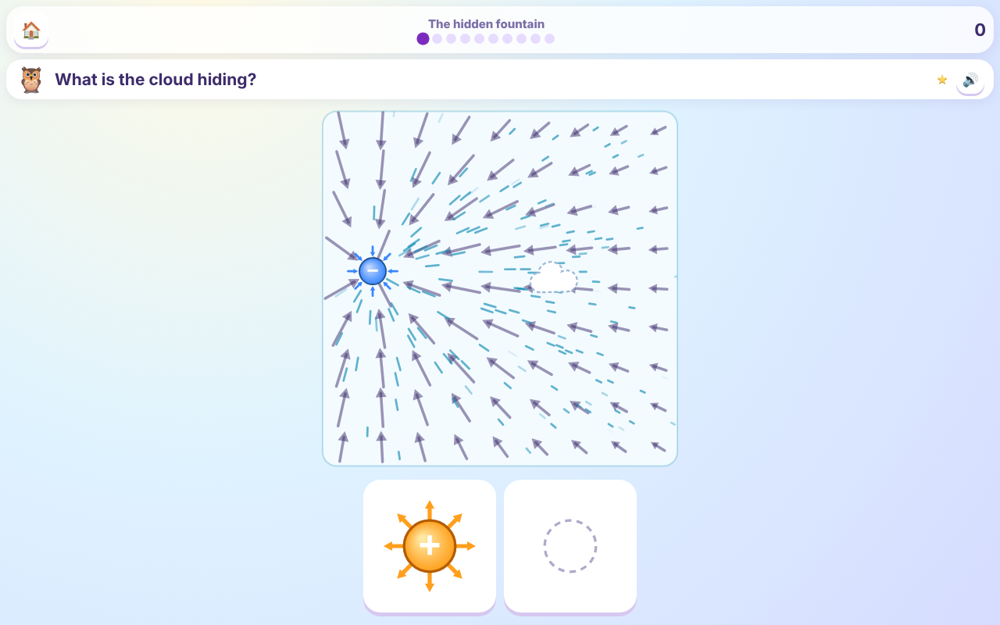
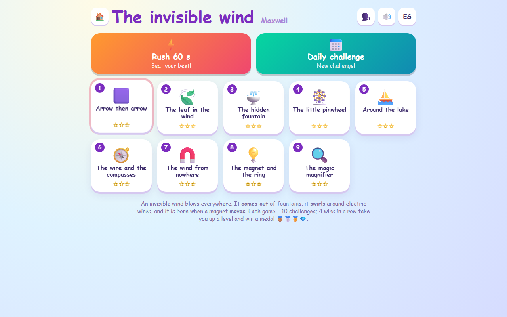

# Strange Mind

### ▶ [Play: edu-fpar.github.io/strange-mind](https://edu-fpar.github.io/strange-mind/?lang=en)

*[Version française](README.md)* · *[Versión en español](README.es.md)*

Source code: [github.com/edu-fpar/strange-mind](https://github.com/edu-fpar/strange-mind)

**Games for children to build intuitions about rotations, complex numbers, matrices, geometric algebra… and
then the ideas behind Maxwell's equations, without ever writing a formula.**

Every game exists in French, English and Spanish: the language button (top right) switches FR → EN → ES, or add
`?lang=en`, `?lang=es` or `?lang=fr` to the address. The choice is remembered for all the games, and the
instructions are read aloud in the chosen language.

## 1 · Shapes that turn (start here, age 5+)

### ▶ [Play: edu-fpar.github.io/strange-mind/v1](https://edu-fpar.github.io/strange-mind/v1/?lang=en)

6 games with 3D shapes that you flip and turn, and instructions read aloud:

| # | Game | Idea |
|---|---|---|
| 1 | The turning machine | multiplying = adding the angles |
| 2 | The magic root | √i, and x² = −1 has two solutions |
| 3 | The changing grid | matrix = transformation |
| 4 | The vanishing garden | determinant 0, 2, −2 |
| 5 | Two mirrors make a turn | reflections → rotation (Hestenes) |
| 6 | The secret whirl | bivector, ab = −ba |

**Free navigation**: every game is open from the start (direct access `v1/#1` to `v1/#6`). The 🎓 button in
each game gives the explanation for grown-ups. See [v1/README.md](v1/README.md) (in French).

## 2 · The invisible wind (next, towards Maxwell's equations, age 6+)

### ▶ [Play: edu-fpar.github.io/strange-mind/maxwell](https://edu-fpar.github.io/strange-mind/maxwell/?lang=en)

9 mini-games to prepare for **∇F = J** (Maxwell in Hestenes' algebra): a "wind" (the field) that **comes out**
of fountains (∇·E = ρ), that **swirls** around wires (Ampère), that comes out of **nowhere** for a magnet
(∇·B = 0), that is born when a magnet **moves** (Faraday), and a magic magnifier that reads "what comes out +
what swirls" in one go, just like "arrow × arrow = bunny + whirl".

Each mini-game has a "do" mode and a "predict" mode, 4 difficulty levels, streaks, medals, a 60-second Rush
and a daily challenge. **Free navigation**: the 9 mini-games are open from the start (direct access
`maxwell/#1` to `#9`). The learning path and the design choices are in [maxwell/README.md](maxwell/README.md)
(in French).

## Run locally

No dependencies: HTML, JavaScript (ES modules) and Canvas 2D. `node tools/serve.mjs` then
http://localhost:8765/ (double-clicking `index.html` is not enough: ES modules need a server).

## Translations

The game is written in French. Each version has its dictionaries: `v1/js/i18n-en.js` and `v1/js/i18n-es.js`,
`maxwell/js/i18n-en.js` and `maxwell/js/i18n-es.js` (French sentence → translation, plus the level texts for
v1). The shared module `i18n.js` picks the language; a sentence missing from the Spanish dictionary is shown in
English.

## The other versions

The other Strange Mind games are prototypes, in [fxpar/kid-games](https://github.com/fxpar/kid-games)
([play](https://fxpar.github.io/kid-games/strange-mind/)): quick challenges (v4), the magic drawers (sequel to
the invisible wind), the full v1 (12 levels), rolling cubes (v2), whirls (v3) and the relation hunt (v5). Their
history remains in this repository, before the commits that moved them.

## Cite

> Parlant, F. (2026). *Strange Mind* [Educational software]. Zenodo. https://doi.org/10.5281/zenodo.24544809

## License

© 2026 François Parlant — [CC BY-NC-SA 4.0 International](https://creativecommons.org/licenses/by-nc-sa/4.0/)
(Attribution · NonCommercial · ShareAlike). You may share and adapt this work, crediting the author ("Strange
Mind, François Parlant", with a link to this repository and the license), for non-commercial purposes only,
and you must distribute your contributions under the same license. See [LICENSE](LICENSE).
