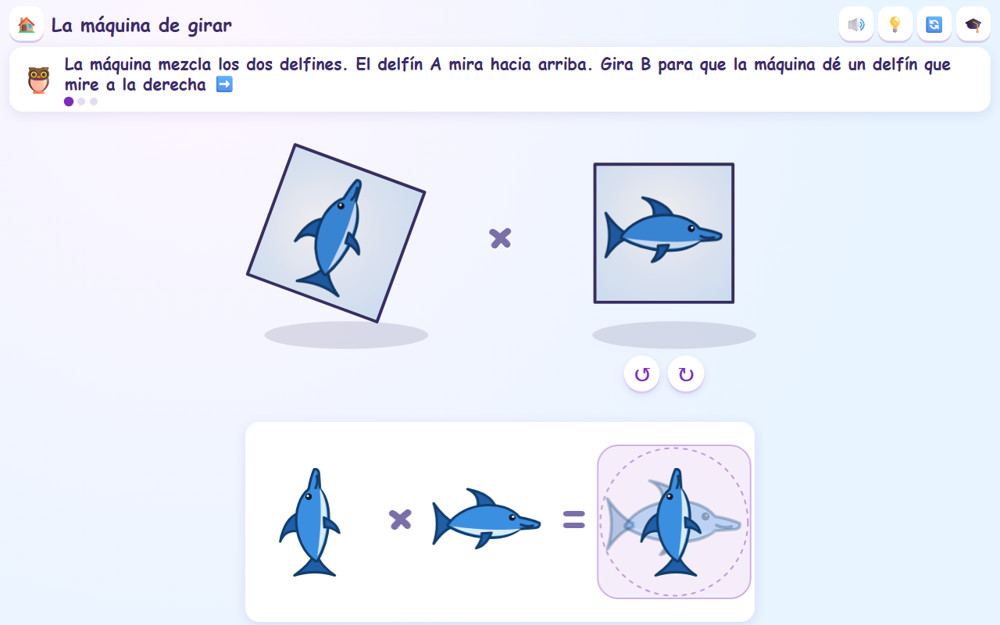
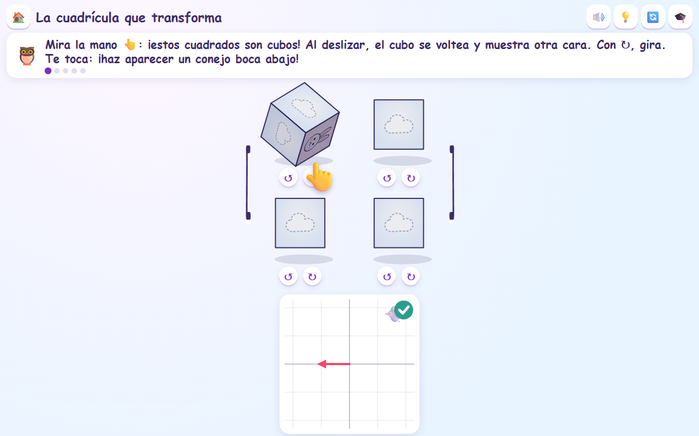
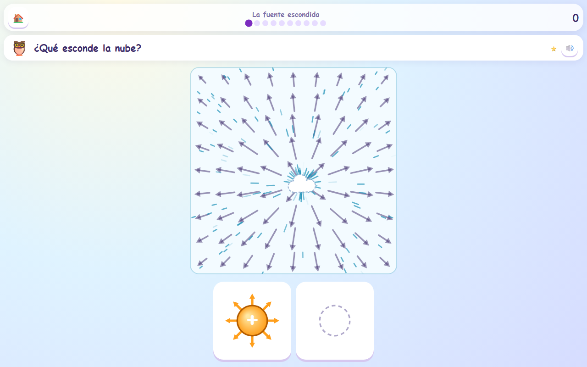
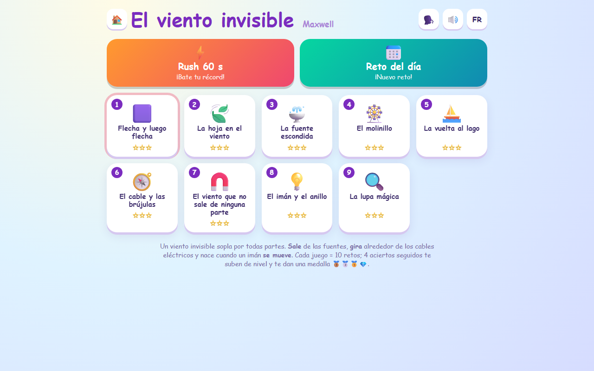

# Strange Mind

### ▶ [Jugar: edu-fpar.github.io/strange-mind](https://edu-fpar.github.io/strange-mind/?lang=es)

*[Version française](README.md)* · *[English version](README.en.md)*

Código fuente: [github.com/edu-fpar/strange-mind](https://github.com/edu-fpar/strange-mind)

**Juegos para que los niños construyan intuiciones sobre las rotaciones, los números complejos, las matrices,
el álgebra geométrica… y después sobre las ideas de las ecuaciones de Maxwell, sin escribir nunca una fórmula.**

Todos los juegos existen en español, francés e inglés: el botón de idioma (arriba a la derecha) pasa de
FR → EN → ES, o añade `?lang=es`, `?lang=en` o `?lang=fr` a la dirección. La elección se recuerda para todos
los juegos, y las instrucciones se leen en voz alta en el idioma elegido.

## 1 · Las formas que giran (para empezar, desde los 5 años)

### ▶ [Jugar: edu-fpar.github.io/strange-mind/v1](https://edu-fpar.github.io/strange-mind/v1/?lang=es)

6 juegos con formas en 3D que se voltean y se giran, con instrucciones leídas en voz alta:

| # | Juego | Idea |
|---|---|---|
| 1 | La máquina de girar | multiplicar = sumar los ángulos |
| 2 | La raíz mágica | √i, y x² = −1 tiene dos soluciones |
| 3 | La cuadrícula que transforma | matriz = transformación |
| 4 | El jardín que desaparece | determinante 0, 2, −2 |
| 5 | Dos espejos hacen un giro | reflexiones → rotación (Hestenes) |
| 6 | El remolino secreto | bivector, ab = −ba |

**Navegación libre**: todos los juegos están abiertos desde el principio (acceso directo `v1/#1` a `v1/#6`).
El botón 🎓 de cada juego da la explicación para los adultos. Ver [v1/README.md](v1/README.md) (en francés).

## 2 · El viento invisible (después, hacia las ecuaciones de Maxwell, desde los 6 años)

### ▶ [Jugar: edu-fpar.github.io/strange-mind/maxwell](https://edu-fpar.github.io/strange-mind/maxwell/?lang=es)

9 minijuegos para preparar **∇F = J** (Maxwell en el álgebra de Hestenes): un «viento» (el campo) que **sale**
de las fuentes (∇·E = ρ), que **gira** alrededor de los cables (Ampère), que no sale de **ninguna parte** en un
imán (∇·B = 0), que nace cuando un imán **se mueve** (Faraday), y una lupa mágica que lee de una vez «lo que
sale + lo que gira», igual que «flecha × flecha = conejo + remolino».

Cada minijuego tiene un modo «hacer» y un modo «prever», 4 niveles de dificultad, rachas, medallas, un Rush de
60 s y un reto del día. **Navegación libre**: los 9 minijuegos están abiertos desde el principio (acceso directo
`maxwell/#1` a `#9`). El recorrido y las decisiones de diseño están en [maxwell/README.md](maxwell/README.md)
(en francés).

## Ejecutar en local

Sin dependencias: HTML, JavaScript (módulos ES) y Canvas 2D. `node tools/serve.mjs` y luego
http://localhost:8765/?lang=es (un doble clic en `index.html` no basta: los módulos ES necesitan un servidor).

## Traducciones

El juego está escrito en francés. Cada versión tiene sus diccionarios: `v1/js/i18n-en.js` y `v1/js/i18n-es.js`,
`maxwell/js/i18n-en.js` y `maxwell/js/i18n-es.js` (frase en francés → traducción, más los textos de los niveles
en v1). El módulo común `i18n.js` elige el idioma; una frase que falte en el diccionario español se muestra en
inglés.

## Las otras versiones

Los otros juegos de Strange Mind son prototipos, en [fxpar/kid-games](https://github.com/fxpar/kid-games)
([jugar](https://fxpar.github.io/kid-games/strange-mind/)): retos relámpago (v4), los
cajones mágicos (continuación del viento invisible), la v1 completa (12 niveles), cubos que ruedan (v2),
remolinos (v3) y la caza de relaciones (v5).

## Citar

> Parlant, F. (2026). *Strange Mind* [Software educativo]. Zenodo. https://doi.org/10.5281/zenodo.24544809

## Licencia

© 2026 François Parlant — [CC BY-NC-SA 4.0 Internacional](https://creativecommons.org/licenses/by-nc-sa/4.0/deed.es)
(Reconocimiento · No comercial · Compartir igual). Puedes compartir y adaptar esta obra citando al autor
(«Strange Mind, François Parlant», con un enlace a este repositorio y a la licencia), sin uso comercial, y
debes difundir tus aportaciones con la misma licencia. Ver [LICENSE](LICENSE).
