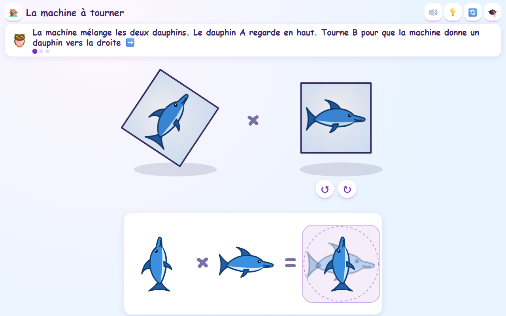
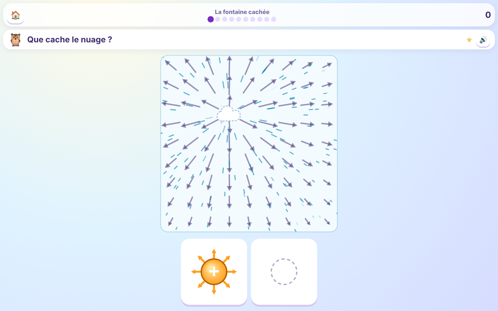
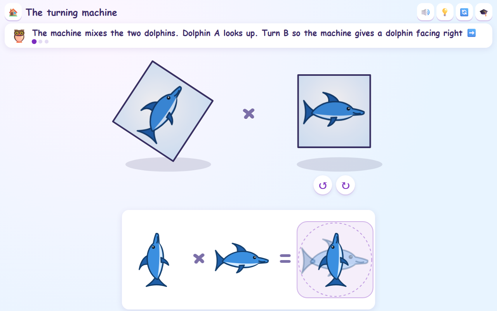

# Strange Mind

> 🇬🇧 English: every game has an English version (EN button, or add `?lang=en` to the address). See [the English summary](#english) below.

**Des jeux pour construire chez les enfants des intuitions sur les rotations, les nombres complexes, les matrices,
l'algèbre géométrique… puis les idées des équations de Maxwell, sans jamais écrire une formule.**

### ▶ [Jouer : edu-fpar.github.io/strange-mind](https://edu-fpar.github.io/strange-mind/)

## 1 · Les formes qui tournent (pour commencer, dès 5 ans)

### ▶ [Jouer : edu-fpar.github.io/strange-mind/v1](https://edu-fpar.github.io/strange-mind/v1/)

6 jeux avec des formes en 3D qu'on fait basculer et tourner, et des consignes lues à voix haute :

| # | Jeu | Notion |
|---|---|---|
| 1 | La machine à tourner | multiplier = additionner les angles |
| 2 | La racine magique | √i, et x² = −1 a deux solutions |
| 3 | La grille qui transforme | matrice = transformation |
| 4 | Le jardin qui disparaît | déterminant 0, 2, −2 |
| 5 | Deux miroirs font un tour | réflexions → rotation (Hestenes) |
| 6 | Le tourbillon secret | bivecteur, ab = −ba |

**Navigation libre** : tous les jeux sont ouverts dès le départ (accès direct `v1/#1` à `v1/#6`). Le bouton 🎓
de chaque jeu donne l'explication pour les adultes. Voir [v1/README.md](v1/README.md).

## 2 · Le vent invisible (ensuite, vers les équations de Maxwell, dès 6 ans)

### ▶ [Jouer : edu-fpar.github.io/strange-mind/maxwell](https://edu-fpar.github.io/strange-mind/maxwell/)

9 mini-jeux pour préparer à **∇F = J** (Maxwell dans l'algèbre de Hestenes) : un « vent » (le champ) qui **sort**
des fontaines (∇·E = ρ), qui **tourne** autour des fils (Ampère), qui ne sort de **nulle part** pour un aimant
(∇·B = 0), qui naît quand un aimant **bouge** (Faraday), et une loupe magique qui lit d'un coup « ce qui sort + ce qui
tourne », comme « flèche × flèche = lapin + tourbillon ».

Chaque mini-jeu a un mode « faire » et un mode « prévoir », 4 niveaux de difficulté, des séries, des médailles, un
Rush 60 s et un défi du jour. **Navigation libre** : les 9 mini-jeux sont ouverts dès le départ (accès direct
`maxwell/#1` à `#9`). Le parcours et les choix de conception sont dans [maxwell/README.md](maxwell/README.md).

## Lancer en local

Aucune dépendance : HTML, JavaScript (modules ES) et Canvas 2D. `node tools/serve.mjs` puis
http://localhost:8765/ (un double-clic sur `index.html` ne suffit pas : les modules ES demandent un serveur).

## Les autres versions

Les autres jeux de Strange Mind sont des prototypes, sur [fxpar/kid-games](https://github.com/fxpar/kid-games)
([jouer](https://fxpar.github.io/kid-games/strange-mind/)) : les défis éclair (v4), les tiroirs magiques (suite du
vent invisible), la v1 complète (12 niveaux), les cubes qui roulent (v2), les tourbillons (v3) et la chasse aux
relations (v5). Leur historique reste dans ce dépôt, avant les commits qui les ont déplacés.

## Licence

© 2026 François Parlant — [CC BY-NC-SA 4.0](https://creativecommons.org/licenses/by-nc-sa/4.0/deed.fr)
(Attribution · Pas d'utilisation commerciale · Partage dans les mêmes conditions, internationale).
Vous pouvez partager et adapter ce projet en citant l'auteur (« Strange Mind, François Parlant », avec un
lien vers ce dépôt et la licence), sans usage commercial, et en diffusant vos modifications sous la même
licence. Voir [LICENSE](LICENSE).

## English

**Strange Mind**: games for children to build intuitions about rotations, complex numbers, matrices, geometric
algebra… and the ideas behind Maxwell's equations, without ever writing a formula.

▶ [Play](https://edu-fpar.github.io/strange-mind/?lang=en)

- **1 · Shapes that turn** (start here) ([play](https://edu-fpar.github.io/strange-mind/v1/?lang=en)), age 5+: six games with
  3D shapes and spoken instructions (the turning machine, the magic root, the changing grid, the vanishing garden,
  two mirrors make a turn, the secret whirl), all open from the start.
- **2 · The invisible wind** ([play](https://edu-fpar.github.io/strange-mind/maxwell/?lang=en)), age 6+: nine
  mini-games towards Maxwell's equations in Hestenes' geometric algebra (∇F = J): fountains, pinwheels, loops,
  wires and compasses, a moving magnet, and a magic magnifier reading "what comes out + what swirls". "Do" and
  "predict" modes, 4 difficulty levels, streaks, medals, a 60-second Rush and a daily challenge. All games are
  open from the start.

The other versions (quick challenges, magic drawers, the full 12-level v1, rolling cubes, whirls, relation hunt)
are prototypes in [fxpar/kid-games](https://github.com/fxpar/kid-games).

**License:** © 2026 François Parlant — [CC BY-NC-SA 4.0 International](https://creativecommons.org/licenses/by-nc-sa/4.0/).
You may share and adapt this work, crediting the author ("Strange Mind, François Parlant", with a link to this
repository and the license), for non-commercial purposes only, and you must distribute your contributions under
the same license. See [LICENSE](LICENSE).
