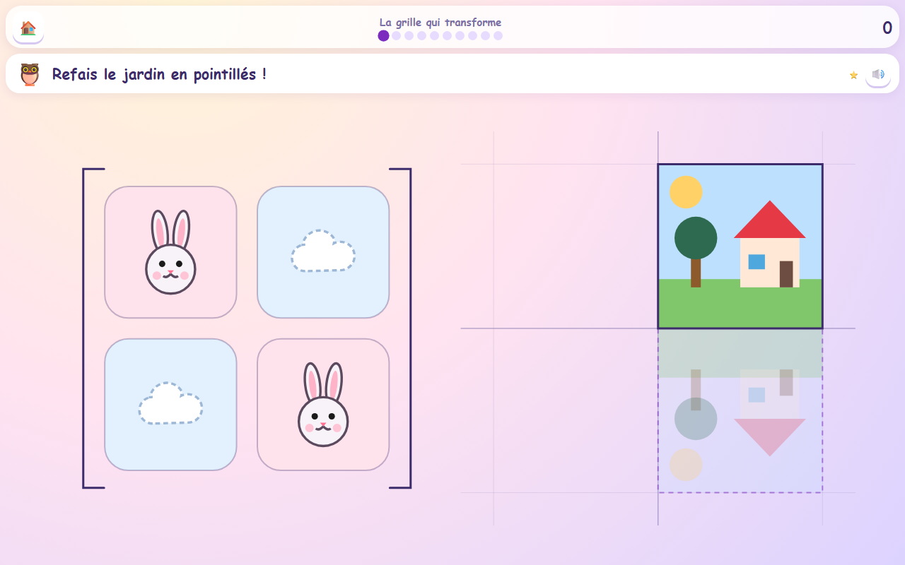
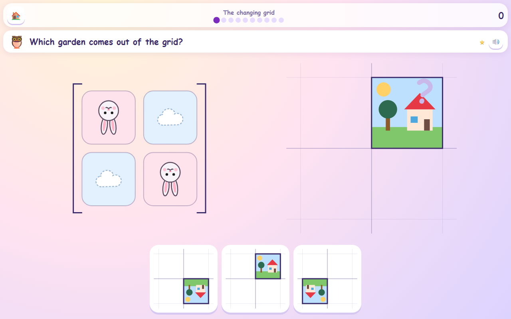

# Strange Mind · Défis éclair

> 🇬🇧 English: every game has an English version (EN button, or add `?lang=en` to the address). See [the English summary](#english) below.

**Des défis de quelques secondes pour construire chez les enfants (dès 5 ans) des intuitions sur les rotations,
les nombres complexes, les matrices et l'algèbre géométrique, sans jamais écrire une formule.**

### ▶ [Jouer : edu-fpar.github.io/strange-mind/v4](https://edu-fpar.github.io/strange-mind/v4/) · [La grille qui transforme](https://edu-fpar.github.io/strange-mind/v4/#6)



Chaque bonne réponse **est** la notion : on ne peut pas réussir sans s'en servir.

## Les 9 mini-jeux (accès direct : `v4/#1` à `v4/#9`)

| # | Mini-jeu | Faire | Prévoir | Notion |
|---|---|---|---|---|
| 1 | Le dauphin a faim | tourner le dauphin vers le poisson | où regardera-t-il après ↺↺ ? | quart de tour = ×i |
| 2 | Le tour à l'envers | un seul bouton ↺ : le bon nombre de tours | « ↺↺↺ fait pareil que… ? » | i³ = −i, inverse |
| 3 | Lapins debout, tête en bas | retourner les lapins pour amener la coccinelle au drapeau | où va la coccinelle ? | +1, 0, −1, opposés |
| 4 | La machine à tourner | A × ? = cible | A × B = ? | multiplier = additionner les angles |
| 5 | La racine magique | ? × ? = cible (puis trouver les DEUX) | A × A = ? | √i, deux solutions |
| 6 | La grille qui transforme | régler la grille pour refaire le jardin | quel jardin sort de la grille ? | matrice = transformation |
| 7 | Le jardin qui disparaît | — | normal 🙂, miroir 🪞 ou écrasé 💨 ? | signe du déterminant |
| 8 | Deux miroirs font un tour | tourner 1 puis 2 miroirs | que voit-on dans le(s) miroir(s) ? | réflexions, 2 miroirs = rotation |
| 9 | Le tourbillon secret | tourner la flèche verte pour obtenir le résultat | flèche × flèche = ? | produit géométrique, bivecteur, ab = −ba |

Chaque mini-jeu a **4 niveaux** de difficulté (par exemple pour le dauphin : 1 quart de tour,
puis 2, puis des tours mélangés, puis l'octogone par huitièmes).

## Ce qui encourage

- **Prévoir puis voir** : après la réponse, l'animation montre ce qui se passe vraiment.
- **Erreur douce** : on montre la bonne réponse, seule la série est perdue.
- **Séries** 🔥 avec sons qui montent, confettis à 3, 5, 10…
- **Difficulté qui s'adapte** : 4 réussites d'affilée → niveau supérieur ; 2 erreurs → on redescend.
- **Étoiles** par partie de 10 défis (6, 8, 10 bonnes réponses) ; une ★ débloque le mini-jeu suivant.
- **Médailles** 🥉🥈🥇💎 : le plus haut niveau maîtrisé (4 réussites d'affilée à ce niveau).
- **Rush 60 s** (tous les mini-jeux débloqués, de plus en plus vite, +2 s toutes les 3 bonnes réponses d'affilée) et **défi du jour** (le même pour tout le monde).
- Consignes lues à voix haute (🗣️ pour couper), aucun texte nécessaire pour jouer.

## Nouveau : le vent invisible (vers les équations de Maxwell)

### ▶ [Jouer : edu-fpar.github.io/strange-mind/maxwell](https://edu-fpar.github.io/strange-mind/maxwell/)

9 mini-jeux, même moteur que les défis éclair, pour préparer à **∇F = J** (Maxwell dans l'algèbre de Hestenes) :
un « vent » (le champ) qui **sort** des fontaines (∇·E = ρ), qui **tourne** autour des fils (Ampère), qui ne
sort de **nulle part** pour un aimant (∇·B = 0), qui naît quand un aimant **bouge** (Faraday), et une loupe
magique qui lit d'un coup « ce qui sort + ce qui tourne », comme « flèche × flèche = lapin + tourbillon ».
Le parcours et les choix de conception sont dans [maxwell/README.md](maxwell/README.md).

Suite : **[les tiroirs magiques](https://edu-fpar.github.io/strange-mind/tiroirs/)** (6 mini-jeux) montrent *pourquoi*
une seule équation suffit : on additionne des choses différentes (lapins, flèches, tapis, cubes) sans les mélanger,
i change une flèche en tapis (B est un bivecteur), deux paniers sont égaux tiroir par tiroir (une équation → quatre
lois), le temps est une direction de plus, et le bord d'une clôture dit ce qu'il y a dedans (Cauchy).
Voir [tiroirs/README.md](tiroirs/README.md).

## Code

```
v4/js/games.js   les 9 mini-jeux : chacun fabrique des défis à l'infini (gen(niveau, hasard, mode))
v4/js/draw.js    dessins partagés (mer, droite des nombres, tuiles-nombres, jardin, grille)
v4/js/main.js    accueil, séances, séries, niveaux, Rush, défi du jour, sons, voix, sauvegarde
v4/js/glyphs.js  dessins des animaux
```

Accès direct : `#3` (mini-jeu 3), `#rush`, `#daily`.
Pour ajouter un mini-jeu : un objet `{ id, name, icon, gen(lvl, R, mode) }` dans `GAMES`
(le format d'un défi est décrit en tête de `js/games.js`).

## Lancer en local

Aucune dépendance : HTML, JavaScript (modules ES) et Canvas 2D. `node tools/serve.mjs` puis
http://localhost:8765/ (un double-clic sur `index.html` ne suffit pas : les modules ES demandent un serveur).

## Les autres versions

Les prototypes qui ont mené aux défis éclair (v1 · leçons guidées, v2 · cubes qui roulent, v3 · tourbillons,
v5 · chasse aux relations) sont sur [fxpar/kid-games](https://github.com/fxpar/kid-games)
([jouer](https://fxpar.github.io/kid-games/strange-mind/)). Leur historique reste dans ce dépôt, avant le
commit qui les a déplacés.

## Licence

© 2026 François Parlant — [CC BY-NC-SA 4.0](https://creativecommons.org/licenses/by-nc-sa/4.0/deed.fr)
(Attribution · Pas d'utilisation commerciale · Partage dans les mêmes conditions, internationale).
Vous pouvez partager et adapter ce projet en citant l'auteur (« Strange Mind, François Parlant », avec un
lien vers ce dépôt et la licence), sans usage commercial, et en diffusant vos modifications sous la même
licence. Voir [LICENSE](LICENSE).

## English

**Strange Mind · Quick challenges**: few-second challenges for children (age 5+) to build intuitions about
rotations, complex numbers, matrices and geometric algebra, without ever writing a formula.

▶ [Play](https://edu-fpar.github.io/strange-mind/v4/?lang=en) · [The changing grid](https://edu-fpar.github.io/strange-mind/v4/?lang=en#6)



Nine mini-games (the turning dolphin, the reverse turn, upside-down rabbits, the turning machine, the magic
root, the changing grid, the vanishing garden, two mirrors make a turn, the secret whirl), each in "do" and
"predict" modes with 4 difficulty levels, streaks, medals, a 60-second Rush and a daily challenge. Instructions
are read aloud; no reading is needed to play. **New: The invisible wind** ([play](https://edu-fpar.github.io/strange-mind/maxwell/?lang=en)), nine
mini-games towards Maxwell's equations in Hestenes' geometric algebra (∇F = J): fountains, pinwheels, loops,
wires and compasses, a moving magnet, and a magic magnifier reading "what comes out + what swirls". Its sequel, **The magic drawers** ([play](https://edu-fpar.github.io/strange-mind/tiroirs/?lang=en)), shows why one
equation is enough: multivectors as drawers, the geometric product, i turning arrows into carpets, grade-by-grade
equality, spacetime worldlines, and boundaries (Cauchy). The earlier prototypes (guided lessons, rolling cubes, whirls,
relation hunt) live in [fxpar/kid-games](https://github.com/fxpar/kid-games).

**License:** © 2026 François Parlant — [CC BY-NC-SA 4.0 International](https://creativecommons.org/licenses/by-nc-sa/4.0/).
You may share and adapt this work, crediting the author ("Strange Mind, François Parlant", with a link to this
repository and the license), for non-commercial purposes only, and you must distribute your contributions under
the same license. See [LICENSE](LICENSE).
